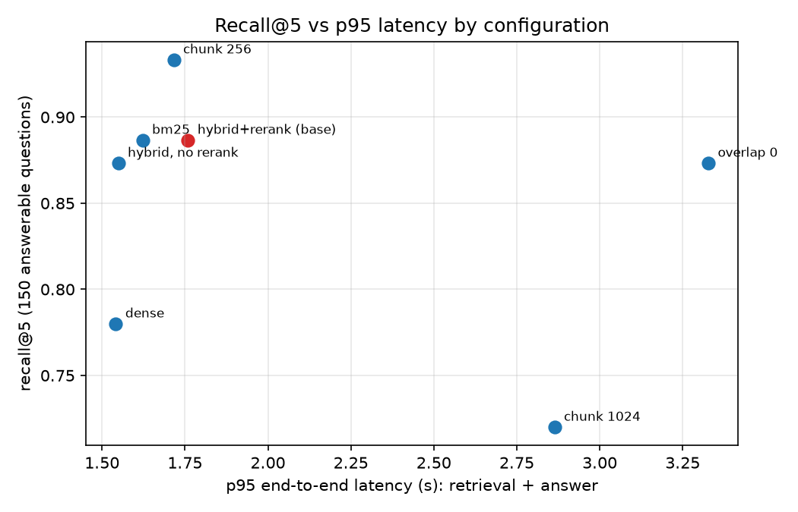
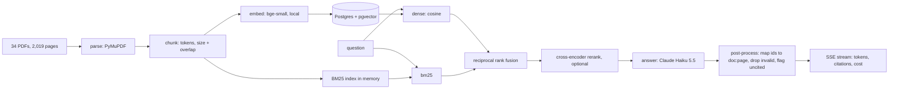

# cited-answer-engine

A retrieval-augmented answer service that cites a document and page for every claim and says `NOT_IN_CORPUS` when the corpus cannot answer.

[](https://github.com/abhiramvedipala/cited-answer-engine/actions/workflows/ci.yml)

## Problem

Engineers and analysts search long technical PDFs (language docs, security standards, engineering handbooks) and need an answer they can verify, not a confident paragraph with no source. Plain LLM answers invent details and never say "this isn't covered". This service answers only from the retrieved passages, links each statement to `doc:page`, and refuses otherwise. I also measure how often it gets that right instead of assuming.

## Demo

Real streamed response from the Docker container ([full transcript](docs/demo-ask.txt)):

```
$ curl -N -X POST localhost:8000/ask -H 'content-type: application/json' \
    -d '{"question":"What is the difference between a data descriptor and a non-data descriptor in Python?"}'
event: token     data: {"t": "A data descriptor is an object that defines __set__() or ..."}
event: citations data: {"answer": "... [1] ...", "refused": false,
                        "citations": [{"n": 1, "source": "python-howto-descriptor:9-10", ...}, ...]}
event: done      data: {"latency_s": 2.554, "cost_usd": 0.00043}
```



## Architecture



Ingest parses each PDF page, cuts token windows that remember which pages they span, embeds them locally and stores them in one Postgres table keyed by chunking config. A question runs through dense and BM25 retrieval, gets fused by rank, optionally reranked, and the top 5 chunks go to the model as numbered passages. The model must cite `[n]` or reply `NOT_IN_CORPUS`. Post-processing maps numbers to `doc:page`, strips citations that are not in the retrieved set, and flags answers with none.

## Tech stack

| Tool | Used for | Why |
|---|---|---|
| PyMuPDF | PDF text per page | Fast on 2,000 pages, keeps page numbers |
| sentence-transformers `bge-small-en-v1.5` | Local embeddings | Zero API cost; 512-token input fits 512-token chunks |
| PostgreSQL + pgvector | Vector store | One database for vectors and chunk metadata; exact scan is fast at 7k rows |
| rank_bm25 | Lexical retrieval | A real BM25 baseline, not Postgres `ts_rank` |
| `ms-marco-MiniLM-L-6-v2` | Cross-encoder reranker | Standard small reranker, runs on CPU |
| Anthropic SDK, Claude Haiku 5.5 | Answers and LLM judge | Cheapest model that follows the citation rules ($0.0005/query) |
| FastAPI + slowapi | Streaming API, per-IP rate limit | SSE streaming and a limiter in a few lines |
| Docker Compose | App + pgvector | One command to run both |
| pytest, ruff, matplotlib | Tests, lint, chart | Small and standard |

## Quick start

Prerequisites: Docker, [uv](https://docs.astral.sh/uv/), Python 3.12, and an `ANTHROPIC_API_KEY` in your shell.

```bash
cp .env.example .env
docker compose up -d db
uv sync && uv run python scripts/download_corpus.py
uv run python -m ingest.run --size 512 --overlap 64      # about 1.5 minutes
ANTHROPIC_API_KEY=... docker compose up -d app            # serves on :8000, rerank off by default
curl -N -X POST localhost:8000/ask -H 'content-type: application/json' \
  -d '{"question":"What does PYTHONSTARTUP do?"}'
```

Run the checks with `scripts/check.sh` (add `--eval` for a paid 13-question smoke run).

## Results

Measured on 150 answerable and 20 unanswerable questions, one run per setup, model `claude-haiku-5-5`. Full tables, column definitions and commands are in [RESULTS.md](RESULTS.md).

| Setup | recall@5 | MRR | Faithfulness | Refusal acc. (20) | $/query | p95 s | Command |
|---|---|---|---|---|---|---|---|
| dense | 0.780 | 0.653 | 0.949 | 1.00 | $0.00047 | 1.54 | `python -m eval.run --config dense` |
| bm25 | 0.887 | 0.758 | 0.977 | 1.00 | $0.00046 | 1.62 | `--config bm25` |
| hybrid + rerank | 0.887 | 0.774 | 0.965 | 1.00 | $0.00047 | 1.76 | `--config hybrid_rerank` |
| chunk 256 | 0.933 | 0.832 | 0.968 | 1.00 | $0.00028 | 1.72 | `--config abl_size256` |
| chunk 1024 | 0.720 | 0.549 | 0.947 | 0.95 | $0.00085 | 2.86 | `--config abl_size1024` |
| overlap 0 | 0.873 | 0.740 | 0.965 | 1.00 | $0.00047 | 3.33 | `--config abl_overlap0` |
| no rerank | 0.873 | 0.738 | 0.970 | 1.00 | $0.00047 | 1.55 | `--config abl_norerank` |

All commands: `uv run python -m eval.run --config all && uv run python -m eval.report`. recall@5 has a 95% interval of about ±0.05, so differences under ~0.05 are noise. Load test, 20 concurrent users: p95 3.55 s with 0 errors in Docker (rerank off), 29.9 s with rerank on in the same container, 4.80 s with rerank on natively.

## How it works

**Page-aware chunks.** A chunk is a window of N embedding-model tokens that may cross a page break, so each one stores `page_start` and `page_end`. Citations print the span (`doc:38-39`), and recall counts a hit when any gold page falls inside a retrieved chunk's span.

**Refusal as a sentinel.** The model must answer exactly `NOT_IN_CORPUS` when the passages lack the answer. A fixed string makes refusal accuracy exact, and an empty retrieval refuses without calling the model.

**Citation checking.** The model cites passage numbers. Post-processing maps them to `doc:page`, deletes any number outside the retrieved set, and flags an answer left with no valid citation.

**Honest eval labels.** Hand questions get their gold page from an anchor phrase that must match exactly where expected. After my first run I found 22 questions whose text repeated across PDFs (the Python license, glossary) and recall was undercounted, so I made all matching pages gold and re-ran everything.

**Streaming with failures.** The 200 header goes out before the model call, so failures travel as an SSE `error` event instead of a silently truncated stream.

## Testing

`uv run pytest -q` runs 36 tests: chunker edge cases (empty doc, shorter than one chunk, exact multiples, overlap, bad parameters, page spans, blank pages, document boundaries), idempotent ingest against real Postgres (skips if it is not running), reciprocal rank fusion, citation mapping and dropping, refusal detection, cost math, metric functions, and the API (SSE event order, validation, 429 rate limit, mid-stream error). `scripts/check.sh` adds lint and verifies the eval set is rebuilt and has 150 + 20 questions.

## Design decisions and trade-offs

Full list with rejected alternatives: [DECISIONS.md](DECISIONS.md). The top three:

1. **Local embeddings and reranker, hosted model only for answers.** Ingest costs nothing and the whole eval cost about $2.32 including a discarded run.
2. **Small LLM judge instead of Ragas.** Fewer dependencies and uniform cost logging, but the judge shares a model family with the answerer, so faithfulness is probably optimistic.
3. **Rerank off by default in Docker.** On CPU in the Docker VM it took p95 from 3.55 s to 29.9 s, and the eval shows it adds 0.036 MRR with no measurable recall@5 gain here.

## Known limits and next steps

- **Failure cases from the eval logs** ([rows](eval/results/hybrid_rerank.jsonl)):
  - *Over-refusal* (`h012`, "What does PYTHONSTARTUP do?"): the right page ranked 7th, outside the top 5, so the model correctly refused with no evidence. NIST control questions like `AC-2` and `RA-5` (`h052`, `h055`) miss for a related reason: control IDs split into weak tokens and there are hundreds of near-identical control pages. Next: retrieve 8 to 10 chunks, and add an exact-ID boost for control names.
  - *Wrong citation* (`s014`, "Which pages mention PYTHONPATH?"): the answer cites five chunks and says pages 12 and 1 "do not mention it", though page 12 does. The real answer lives in the index pages, which were never retrieved. This is also a weak question (meta, about pages); script-generated questions need a filter for those.
  - *Unsupported detail* (`s070`, SC-7 "Fail Secure"): the answer states the identifier `SC-7(18)`, but the cited page 329 never contains that string. The identifier is only in the baseline table on page 485, which was not retrieved. The detail is true but not grounded, which is the failure the prompt should forbid. Next: a post-check that every identifier in the answer appears in a cited chunk.
- Hand-written questions need human review; I wrote them from passages in the corpus and a sample should be spot-checked.
- 82 questions are generated by the same model family that answers and judges them, which can flatter results. A different judge model would test this.
- One run per setup, so LLM sampling noise is not measured. Re-running with seeds and paired tests would tighten the ablation claims.
- The 1024-token config embeds only the first 512 tokens per chunk.
- Single shared Postgres connection and in-process BM25; fine at this scale, not at millions of chunks.

## Project structure

```
ingest/      parse PDFs, chunk with page spans, embed locally, load pgvector
retrieval/   dense, bm25, hybrid (RRF), cross-encoder rerank behind one interface
answer/      Anthropic wrapper with cost logging; citation and refusal post-processing
eval/        question builders, runner, metrics, judge, report; questions.jsonl; results/
service/     FastAPI app: /ask (SSE), /health, rate limit, request log
scripts/     download_corpus.py (checksummed), load_test.py, check.sh
tests/       36 tests
docs/        chart, results tables, demo transcript, interview notes
```
