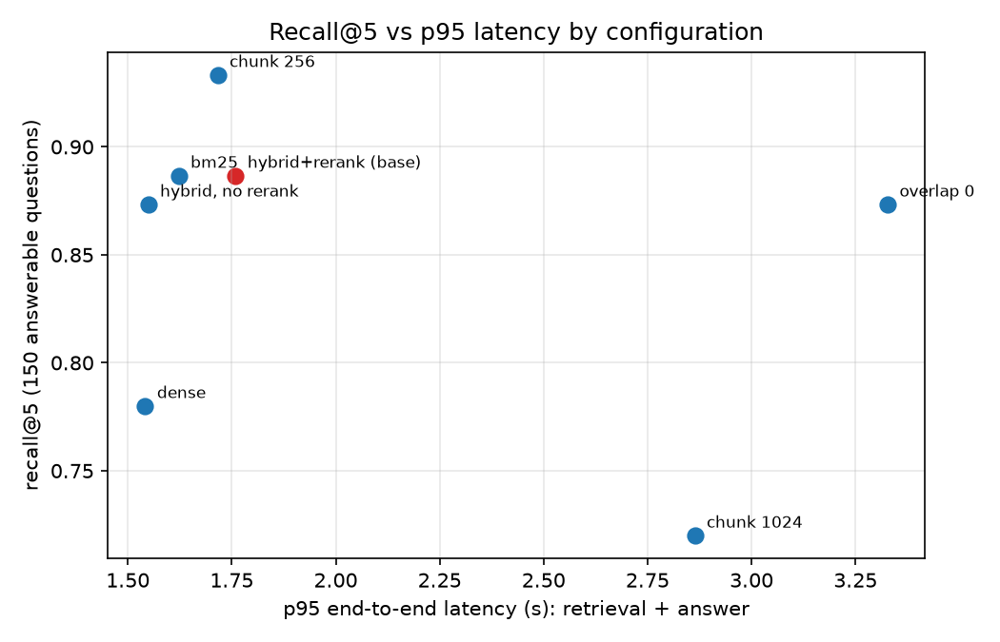

# Results

Every number below comes from a script in this repo. Re-run commands are next to each table.
Single run per setup, 150 answerable + 20 unanswerable questions, model `claude-haiku-5-5`.

## Corpus

| Item | Value | Command |
|---|---|---|
| Pages | 2,019 across 34 PDFs | `uv run python scripts/download_corpus.py` then `uv run python -m eval.report` |
| Sources | Python 3.12 docs (30 PDFs, excluding library and C API), NASA SE Handbook, NIST SP 800-53r5, 800-61r2, 800-207 | same |
| Chunks | 2,831 (512/64), 6,578 (256/64), 1,331 (1024/64), 2,484 (512/0) | `uv run python -m ingest.run --size N --overlap M` |

## Eval set

| Item | Value |
|---|---|
| Answerable | 150: 82 script-generated from headings, 68 hand-written |
| Unanswerable | 20 (out of corpus; a few are near misses where the corpus mentions the term only in passing) |
| Gold | doc + page. 143 questions have one gold page, 6 have two, 1 has six (text repeated across PDFs) |
| Build | `uv run python -m eval.build_questions` (fails if a gold anchor does not match) |

## Retrieval and ablations

Command: `uv run python -m eval.run --config all` then `uv run python -m eval.report`
(single setup: `--config dense|bm25|hybrid_rerank|abl_size256|abl_size1024|abl_overlap0|abl_norerank`).

### Retrieval setups (chunk 512 / overlap 64)

| Setup | Chunk/overlap | Rerank | recall@5 (±95% CI) | recall@10 | MRR | Faithfulness | Relevance | Cites gold | Refusal acc. (20) | Over-refusal | $/query | p50 s | p95 s | retrieval p95 s |
|---|---|---|---|---|---|---|---|---|---|---|---|---|---|---|
| dense | 512/64 | no | 0.780 ±0.066 | 0.867 | 0.653 | 0.949 | 0.885 | 0.784 | 1.00 | 0.073 | $0.00047 | 1.07 | 1.54 | 0.035 |
| bm25 | 512/64 | no | 0.887 ±0.051 | 0.940 | 0.758 | 0.977 | 0.887 | 0.887 | 1.00 | 0.053 | $0.00046 | 1.01 | 1.62 | 0.006 |
| hybrid+rerank (base) | 512/64 | yes | 0.887 ±0.051 | 0.920 | 0.774 | 0.965 | 0.917 | 0.890 | 1.00 | 0.033 | $0.00047 | 1.25 | 1.76 | 0.225 |

### Ablations (each row changes one thing from hybrid+rerank)

| Setup | Chunk/overlap | Rerank | recall@5 (±95% CI) | recall@10 | MRR | Faithfulness | Relevance | Cites gold | Refusal acc. (20) | Over-refusal | $/query | p50 s | p95 s | retrieval p95 s |
|---|---|---|---|---|---|---|---|---|---|---|---|---|---|---|
| hybrid+rerank (base) | 512/64 | yes | 0.887 ±0.051 | 0.920 | 0.774 | 0.965 | 0.917 | 0.890 | 1.00 | 0.033 | $0.00047 | 1.25 | 1.76 | 0.225 |
| chunk 256 | 256/64 | yes | 0.933 ±0.040 | 0.967 | 0.832 | 0.968 | 0.897 | 0.932 | 1.00 | 0.020 | $0.00028 | 1.19 | 1.72 | 0.353 |
| chunk 1024 | 1024/64 | yes | 0.720 ±0.072 | 0.807 | 0.549 | 0.947 | 0.853 | 0.728 | 0.95 | 0.093 | $0.00085 | 1.24 | 2.86 | 0.186 |
| overlap 0 | 512/0 | yes | 0.873 ±0.053 | 0.927 | 0.740 | 0.965 | 0.929 | 0.901 | 1.00 | 0.060 | $0.00047 | 1.29 | 3.33 | 0.221 |
| hybrid, no rerank | 512/64 | no | 0.873 ±0.053 | 0.913 | 0.738 | 0.970 | 0.900 | 0.847 | 1.00 | 0.040 | $0.00047 | 1.03 | 1.55 | 0.042 |

Judge cost across all 7 runs: $0.477 (not in $/query).

Column notes:
- recall@5: a gold page falls inside the page span of one of the top 5 chunks. The interval is a
  95% normal approximation for 150 questions, about +/-5 points.
- Faithfulness: supported claims / total claims, scored by an LLM judge on the 5 passages the
  answerer saw. Relevance: judge rating 1-5 mapped to 0-1. Both are over answered questions only.
- Cites gold: share of answered questions where a cited chunk's page span covers a gold page.
- Refusal acc.: of the 20 unanswerable questions, how many got exactly `NOT_IN_CORPUS`.
- Over-refusal: share of the 150 answerable questions that got `NOT_IN_CORPUS`.
- $/query: answer call only. Judge cost is excluded and listed below the tables.
- p50/p95: retrieval time + that answer call's streaming time. The "retrieval p95" column is
  retrieval alone, so the config effect can be separated from API tail latency.
- Uncited rate was 0.0 in all seven runs (no answer was left with zero valid citations).

## What the numbers say, and what they do not

- BM25 ties hybrid+rerank on recall@5 (0.887 each). On this corpus, full of exact identifiers
  like `PYTHONSTARTUP` and `AC-2`, lexical matching is strong. Dense alone is lowest (0.780).
- Reranking did not move recall@5 (0.887 vs 0.873, inside the interval). It raised MRR by 0.036
  and cut over-refusal from 4.0% to 3.3%. These gaps are too small to call at n=150.
- Smaller chunks did best: 256 gave 0.933 and 1024 gave 0.720. The 1024 gap is clear. The 256 vs
  512 gap (+0.047) overlaps the intervals, so I call it suggestive. The 1024 run embeds only the
  first 512 tokens of each chunk (embedding model limit), which probably contributes.
- Overlap 64 vs 0 is not distinguishable (0.887 vs 0.873).
- p95 for `overlap 0` (3.33 s) and `chunk 1024` (2.86 s) comes from API tail latency, not the
  config: their retrieval p95 is about 0.2 s like the others.
- The judge is the same model family as the answerer, so faithfulness is probably optimistic.
  One manual check found a judge false negative (`s041`: the claim was supported on page 56).

## Service load test (20 concurrent users, 5 requests each, 100 requests)

Command: `RATE_LIMIT=100000/minute docker compose up -d app` then
`uv run python -m scripts.load_test --users 20 --per-user 5`

| Deployment | Rerank | Errors | Throughput | TTFT p95 | Total p95 | Cost/request |
|---|---|---|---|---|---|---|
| Docker (4-CPU VM), default | off | 0 | 10.0 req/s | 3.05 s | 3.55 s | $0.000465 |
| Docker (4-CPU VM) | on | 0 | 0.78 req/s | 29.4 s | 29.9 s | $0.000468 |
| Native macOS | on | 0 | 5.5 req/s | 4.37 s | 4.80 s | $0.000470 |

The per-IP limiter returns 429 on the container (demonstrated with `RATE_LIMIT=3/minute`: three
requests accepted, the fourth rejected) and is covered by `tests/test_api.py`.

## Spend

7,012 logged LLM calls over the whole build cost $2.32 (including one discarded eval run,
question generation and load tests). One eval run of all seven setups costs about $0.48 in judge
calls plus about $0.07 in answer calls per setup.
